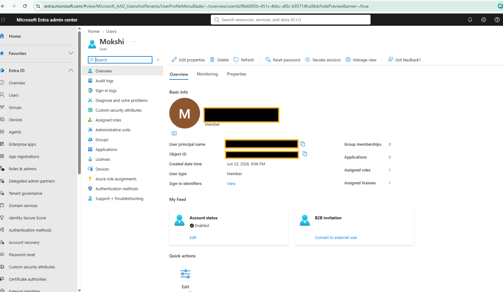
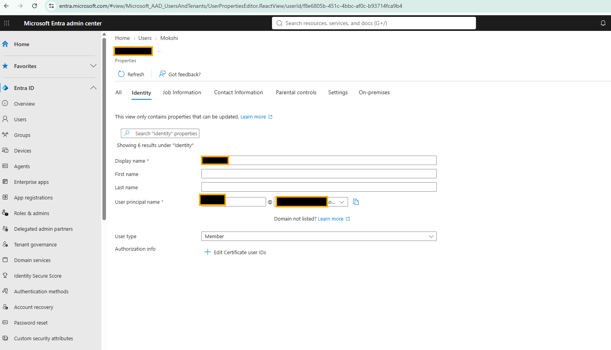
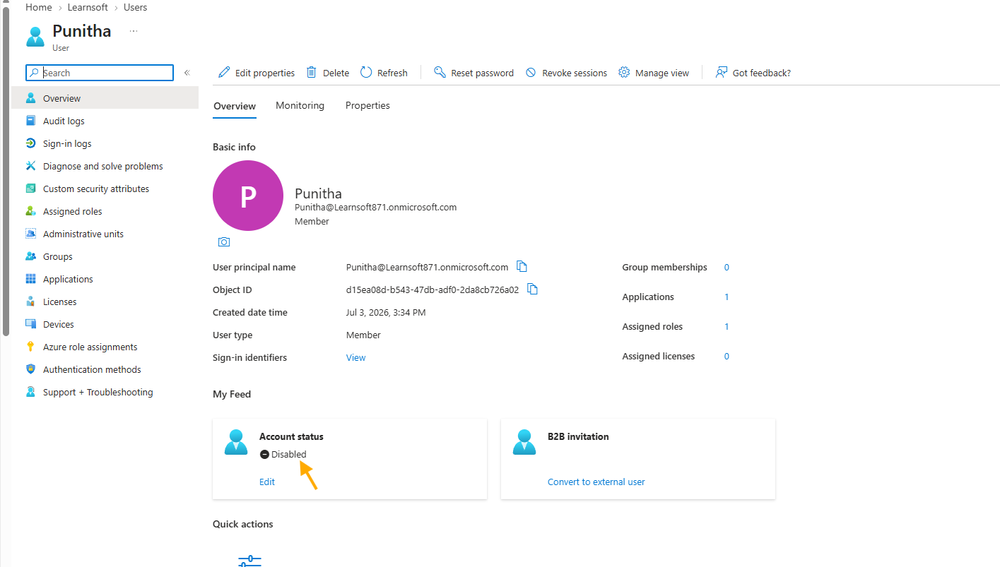
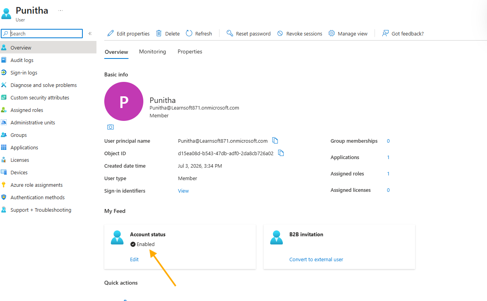
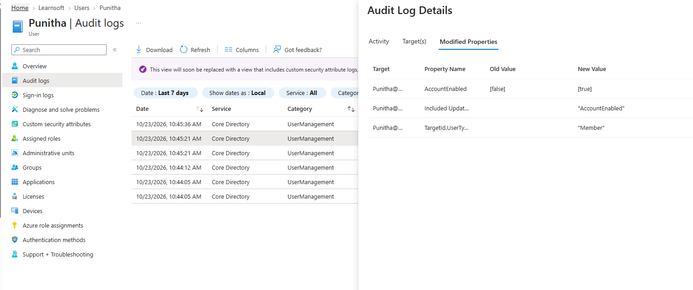
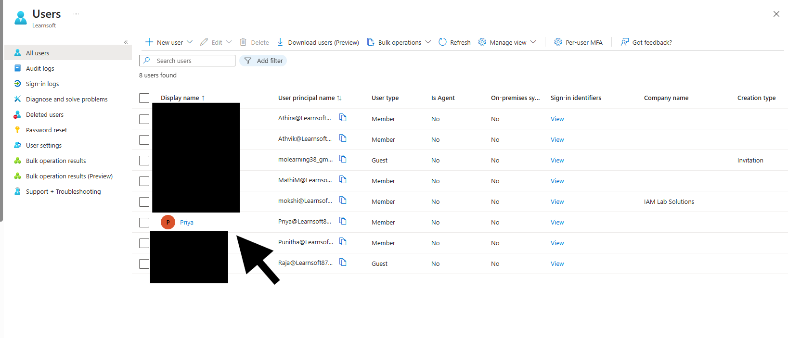

# Lab 01 – Microsoft Entra ID User Creation and Management

## Objective
Demonstrate user account management in Microsoft Entra ID, including identity attributes, account status changes, audit logging, and account recovery.

## Lab Environment
- Microsoft Entra Admin Center
- Microsoft Entra ID test tenant
- Test user accounts

## Scenario
An IAM administrator manages employee identities throughout their lifecycle, ensuring that user information is maintained, account access is controlled, and administrative changes are auditable.

## Implementation Steps

### 1. User Account Verification
- Opened an existing test user in Entra ID.
- Verified user type, account status, assigned roles and licenses.

### 2. User Attribute Management
Updated and verified the following employee attributes:

| Attribute | Value |
|---|---|
| Job Title | IT Support Analyst |
| Department | IT |
| Company | IAM Lab Solutions |
| Employee ID | LAB1001 |
| Employee Type | Employee |
| Office Location | Singapore |

### 3. Account Status Management
- Verified a test account in Disabled status.
- Re-enabled the account.
- Confirmed the status changed to Enabled.

### 4. Audit Log Verification
- Reviewed user management audit logs.
- Verified the AccountEnabled property changed from false to true.
- Confirmed that Entra ID recorded the administrative change.

### 5. User Deletion and Restoration
- Deleted a disposable test user.
- Restored the user from Deleted users.
- Verified that the restored account appeared in All users.

## Validation Results

| Test Scenario | Result |
|---|---|
| Verify existing user | Passed |
| Update employee attributes | Passed |
| Re-enable user account | Passed |
| Verify account status audit log | Passed |
| Delete and restore test user | Passed |

## Key Learning
This lab demonstrates how Microsoft Entra ID supports user identity administration, account lifecycle operations, and auditability.

## Status
**Completed**
