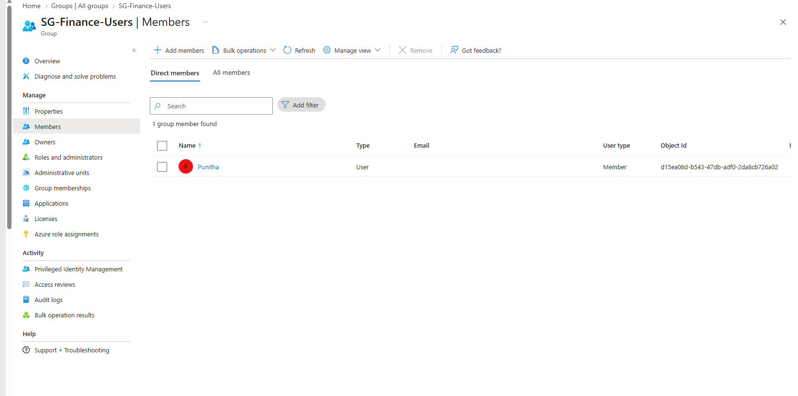
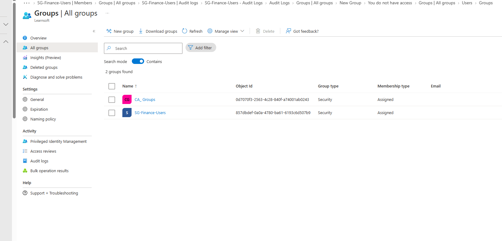
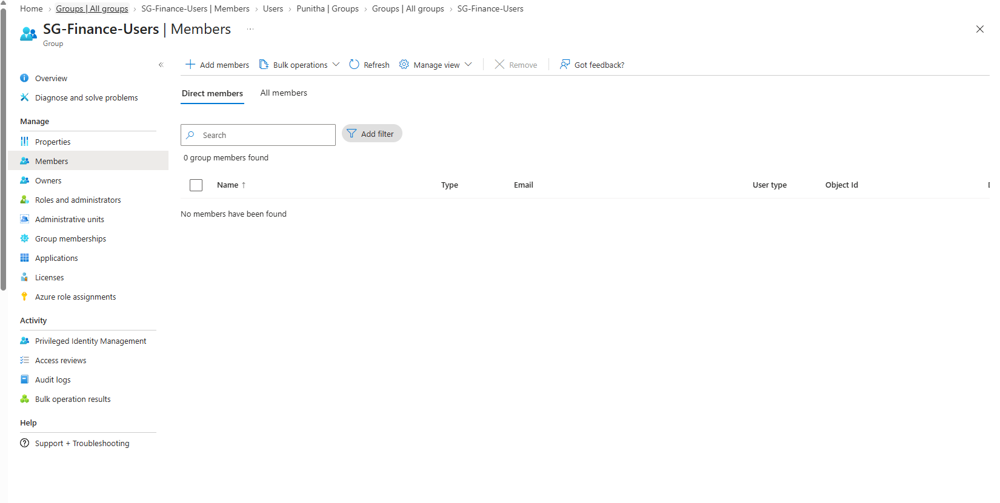
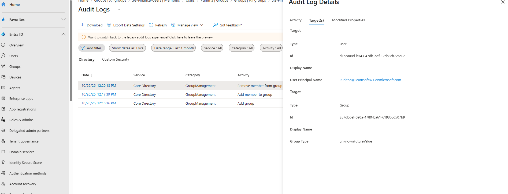

# Lab 02 – Microsoft Entra ID Security Groups and Membership

## Objective
Demonstrate how security groups are used to manage user membership and support group-based access control in Microsoft Entra ID.

## Lab Environment
- Microsoft Entra Admin Center
- Microsoft Entra ID test tenant
- Test user accounts

## Scenario
An employee joins the Finance department and is added to a Finance security group. When the employee transfers to another department, the membership is removed to support access revocation.

## Implementation Steps

### 1. Security Group Creation and Member Assignment
- Created a Security group named `SG-Finance-Users`.
- Configured membership type as Assigned.
- Added a test user to the group.



### 2. Verify User Group Membership
- Opened the test user's profile.
- Verified that `SG-Finance-Users` appeared under group memberships.



### 3. Remove Group Membership
- Removed the test user from `SG-Finance-Users`.
- Verified that the user no longer appeared in the group's member list.



### 4. Audit Log Verification
- Reviewed the Entra ID group audit logs.
- Verified the successful group membership removal event.



## Assigned vs Dynamic Membership

| Assigned Membership | Dynamic Membership |
|---|---|
| Members are added or removed manually. | Membership is calculated automatically using rules. |
| Used in this lab. | Conceptual review only; configuration access was unavailable. |
| Example: Admin assigns a Finance user. | Example: Department equals Finance. |

Example dynamic membership rule:

```text
user.department -eq "Finance"
```

## Validation Results

| Test Scenario | Result |
|---|---|
| Create Finance security group | Passed |
| Add user to security group | Passed |
| Verify user membership | Passed |
| Remove user from security group | Passed |
| Verify membership change in audit logs | Passed |
| Configure dynamic group | Not tested – access unavailable |

## Key Learning
Microsoft Entra ID security groups centralize membership management. When access to a resource is assigned through a group, membership changes can affect authorization. Audit logs provide traceability for administrative changes.

## Status
**Completed – Assigned Group Management**
  
