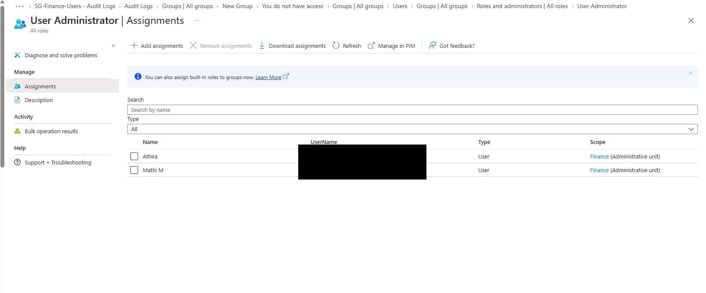
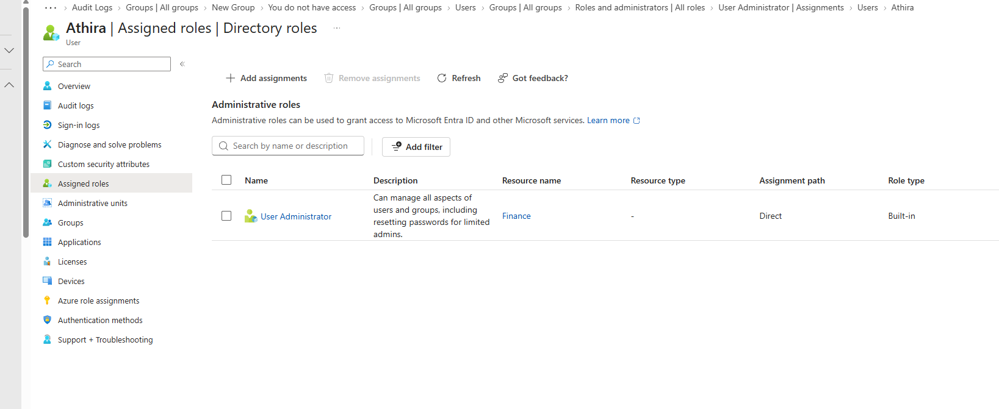
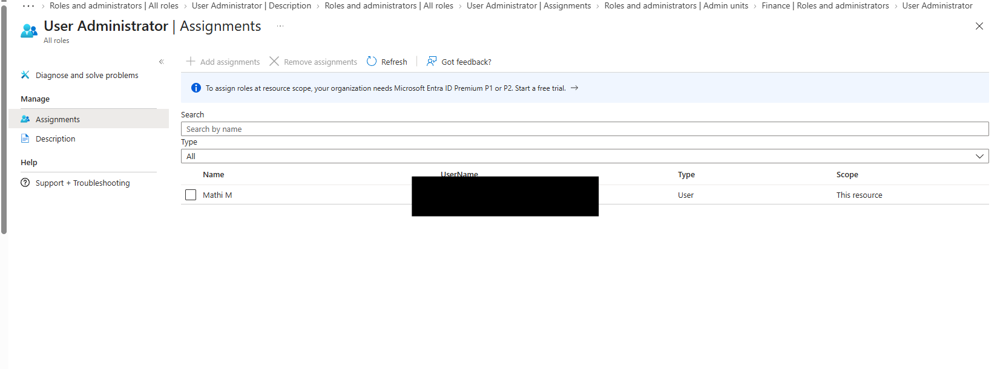
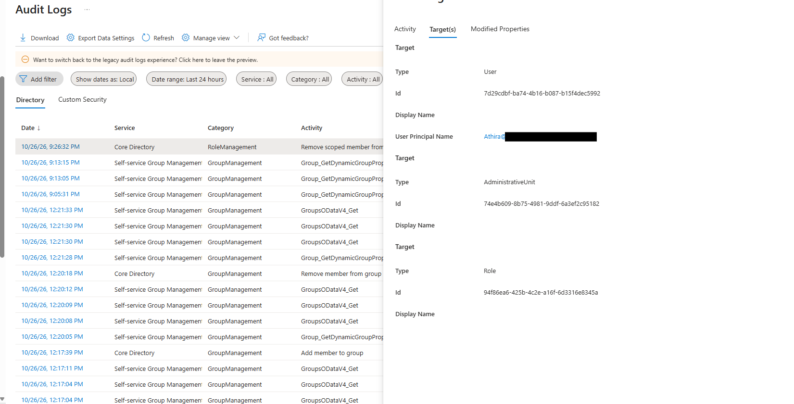

# Lab 03 – Microsoft Entra ID Role-Based Access Control (RBAC)

## Objective
Demonstrate administrative role assignment, verification and revocation in Microsoft Entra ID using least-privilege principles.

## Lab Environment
- Microsoft Entra Admin Center
- Microsoft Entra ID test tenant
- Non-administrator test account

## Scenario
An IT Support Analyst requires delegated user-management permissions without receiving unrestricted Global Administrator privileges. The administrative role must be assigned, verified and removed when no longer required.

## Implementation Steps

### 1. Role Assignment
- Reviewed the built-in User Administrator role.
- Assigned User Administrator to a test account.
- Reviewed the role assignment scope.

### 2. Role Verification
- Opened the test user's Assigned roles page.
- Verified that User Administrator was assigned.
- Reviewed the role's built-in permissions and limitations.

### 3. Role Revocation
- Selected the test user's User Administrator assignment.
- Removed the assignment after confirming the correct scope.
- Verified the role was no longer assigned.

### 4. Audit Log Verification
- Reviewed Microsoft Entra ID audit logs under RoleManagement.
- Located the successful Remove scoped member from role event.
- Verified the intended role removal using the audit details.

## Troubleshooting Observation
During the lab, the Remove assignments option was initially unavailable while reviewing an assignment scoped to the Finance administrative unit. The assignment scope and selected user were reviewed before correcting the operation.

**Learning:** Administrative role assignments can have different scopes. Always verify the target identity and scope before making privilege changes.

## Validation Results

| Test Scenario | Result |
|---|---|
| Review User Administrator permissions | Passed |
| Assign administrative role | Passed |
| Verify assigned role | Passed |
| Remove administrative role | Passed |
| Verify role removal audit event | Passed |

## Key Learning
Microsoft Entra ID RBAC allows administrative permissions to be delegated based on job responsibilities. The User Administrator role provides defined user-management capabilities without granting unrestricted Global Administrator access. Assignment scope, least privilege and audit logging are important controls.

## Status
**Completed**
